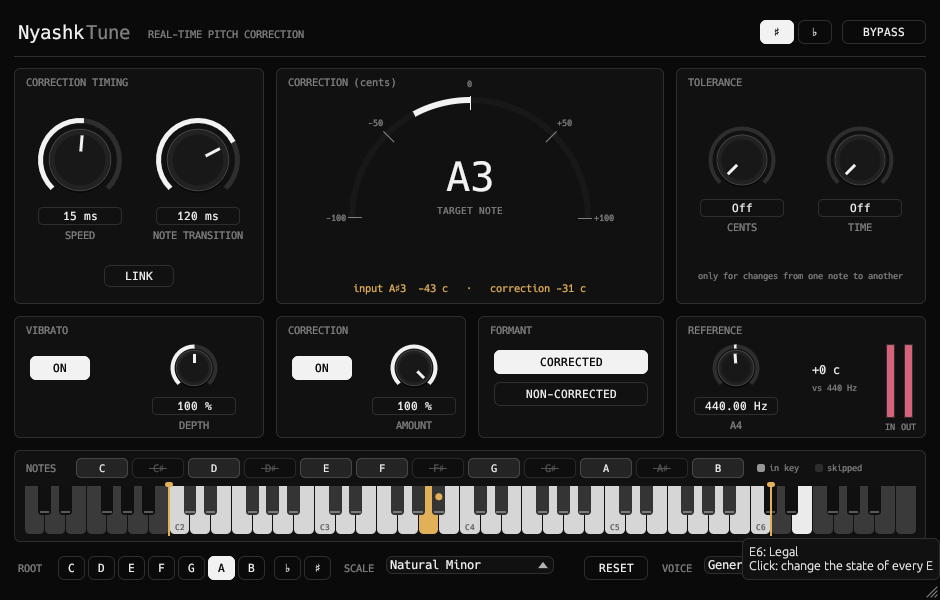

<div align="center">

# NyashkTune

NyashkTune is a real-time vocal pitch correction VST3 plugin.

[](https://github.com/xslimakx/NyashkTune/actions/workflows/build.yml)
[](LICENSE)


[**Download**](https://github.com/xslimakx/NyashkTune/releases/latest)

</div>

---

## 🎶 NyashkTune — real-time pitch correction

Real-time vocal pitch correction with the controls of a classic real-time tuner, from transparent tuning that keeps the singer's own vibrato to a hard quantized effect.

<p align="center"></p>

### Controls

| | |
|---|---|
| **Speed** | How fast a sustained note is pulled onto the target and held there (0.1–800 ms, default 15 ms). |
| **Note Transition** | How fast the correction moves when the target note changes (0.1–800 ms, default 120 ms). **Link** moves both together. |
| **Tolerance** | **Cents** (Off–40): extra margin beyond the 50 c border between notes before the target changes. **Time** (Off–300 ms): how long the voice must stay past it. Off / Off = straight to the nearest legal note. |
| **Vibrato** | **On** (default): only the note centre is corrected and the singer's own vibrato is kept, scaled by **Depth** (0 % flat, 100 % as sung, 200 % twice as wide). **Off**: the whole pitch is corrected (with fast Speed / Transition: the hard quantized effect). |
| **Correction** | On / Off and the amount (1–100 %) of the correction applied. |
| **Formant** | **Corrected** keeps the natural timbre while shifting; **Non-corrected** lets it follow the pitch (pitch-shifter character). |
| **Reference** | A4 from 415.3 to 466.16 Hz (±100 cents), e.g. for a sped-up beat. |
| **Keyboard** | Click the strip above a key to cycle the note's state (all octaves): **Legal**, **Illegal** (to the nearest legal note), **Illegal – pitch up / down** (to the next legal note in that direction), **Bypass** (legal, left as sung). Drag the two orange edges to set the correction **range** – notes outside it pass uncorrected. The sung note (dot) and the target note are shown live. |
| **Root / Scale** | Root C–B with ♭ / ♯, 16 scales + Custom (all illegal, set the keys yourself). A hand-edited keyboard shows `*` after the scale name; **Reset** goes back to the scale. |
| **Voice** | Generic, Bass, Baritone, Tenor, Alto, Mezzo-Soprano, Soprano: sets the range. |
| **MIDI** | The notes held on the plugin's MIDI input are the legal notes. |
| **Meter** | The arc shows the correction applied in cents and the target note; IN / OUT peak meters. |

The note is always chosen on the note centre (vibrato taken out, from the last vibrato peak and trough), so a wide vibrato never flips the target to a neighbouring note. Whatever the Tolerance, the tuner never pulls the voice further than its own target for more than ~12 ms, and never by a whole octave.

### How it works

```
input → high-pass → decimate → YIN (with continuity) → pitch frames (every ~4 ms)
      → pitch-mark tracker (one mark per period, aligned by waveform correlation)
      → PSOLA grain synthesiser: for every output grain
          1. pick the analysis mark that continues the previous one,
          2. look up the pitch at that moment of the audio (centred median of frames),
          3. note centre (vibrato removed) → target note by the note states and Tolerance,
             correction with Speed / Note Transition, vibrato kept or flattened,
          4. overlap-add a Hann grain; the hop is the real distance to the next pitch mark
             divided by the ratio, so with no correction the voice is rebuilt unchanged
```

The latency (≈ 27–37 ms, reported to the host) comes from the pitch detector and depends on the lowest note of the range.

---

## Installation

Download the archive for your OS from [Releases](https://github.com/xslimakx/NyashkTune/releases/latest), unzip it and copy `NyashkTune.vst3` into your VST3 folder:

| OS | Path |
|---|---|
| Linux | `~/.vst3/` or `/usr/lib/vst3/` |
| Windows | `C:\Program Files\Common Files\VST3\` |
| macOS | `~/Library/Audio/Plug-Ins/VST3/` |

## Building from source

Needs [Rust](https://rustup.rs/) (stable). `cargo test -p nyashktune` runs the DSP tests (transitions, vibrato, tolerance, transparency, fuzzing of all parameters). `NYASHK_VOICE_DIR=folder` adds a check on your own recordings (raw mono f32, 48 kHz). Linux: `libasound2-dev libgl-dev libx11-xcb-dev libxcb1-dev libxcb-icccm4-dev libxcursor-dev libxkbcommon-dev libxcb-dri2-0-dev`.

```bash
git clone https://github.com/xslimakx/NyashkTune.git
cd NyashkTune
cargo xtask bundle -p nyashktune --release   # -> target/bundled/NyashkTune.vst3
cargo run --release -p nyashktune --features standalone   # standalone test app
```

## License

[MIT](LICENSE). Note: compiled `.vst3` builds link GPLv3 `vst3-sys` bindings (via NIH-plug), so GPLv3 terms apply when you distribute compiled binaries. Crates in `vendor/` keep their own licenses.

Part of the Nyashk plugins family: [NyashkOpto](https://github.com/xslimakx/NyashkOpto) · [NyashkSynth](https://github.com/xslimakx/NyashkSynth)
