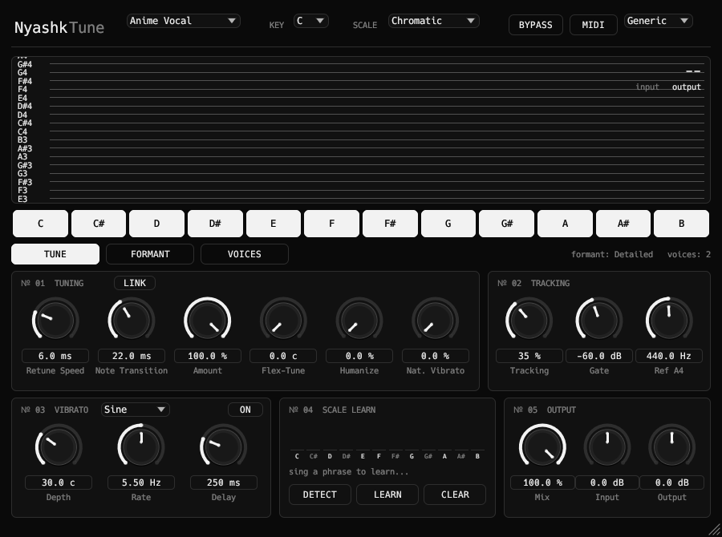
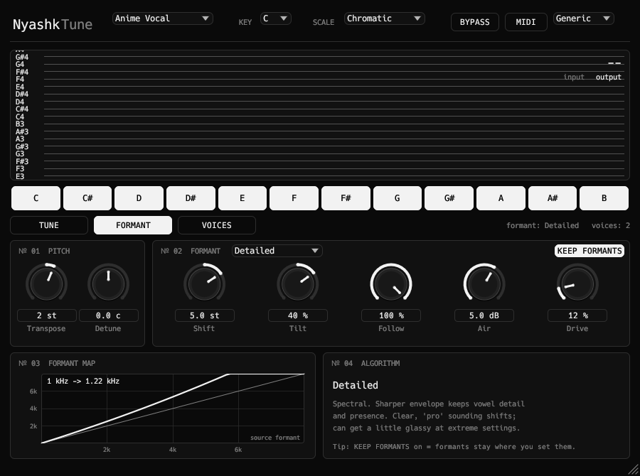
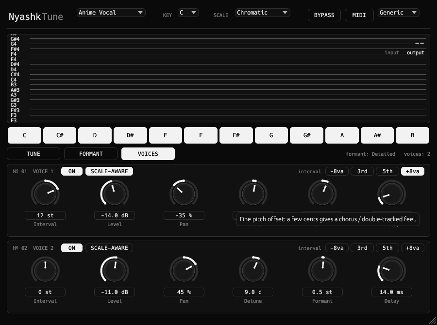

<div align="center">

# NyashkTune

NyashkTune is a realtime vocal pitch correction (autotune) VST3 plugin.

[](https://github.com/xslimakx/NyashkTune/actions/workflows/build.yml)
[](LICENSE)


[**Download**](https://github.com/xslimakx/NyashkTune/releases/latest)

</div>

---

## 🎶 NyashkTune — autotune

Realtime vocal pitch correction, from transparent, natural-sounding tuning to the hard T-Pain effect.

<p align="center"></p>
<p align="center"> </p>

### Features

| | |
|---|---|
| **Pitch detection** | YIN with continuity tracking (no octave jumps), centred in time |
| **Resynthesis** | PSOLA on pitch marks, mono/stereo |
| **Scales** | 16 scales + **Custom** (click notes C…B), key, Ref A4 (415–466 Hz) |
| **Per-note BYPASS** | Right-click a note: it is allowed as a target but sung exactly as it is (blue-note / slide friendly) |
| **Scale Learn** | Live pitch-class histogram of what you sing, **DETECT** the key (major/minor), **LEARN** it into a Custom scale |
| **Character** | Retune Speed (0 = hard T-Pain), Note Transition, **LINK**, Amount, Flex-Tune, Humanize, Natural Vibrato, **Tracking** (how reluctantly it jumps to another note) |
| **Vibrato** | Synthetic vibrato: Depth / Rate / Delay, shapes Sine / Triangle / Saw / Wander |
| **MIDI Target** | Tunes to the notes you play on a MIDI keyboard |
| **Timbre** | Transpose (±12 st), Detune (±100 c), **Formant Shift** with 5 algorithms, Tilt, Follow, Keep Formants |
| **Voices** | 2 extra voices (harmony / octave / double): interval, scale-aware snapping, level, pan, detune, formant, delay |
| **Colour** | Air (7 kHz shelf) and Drive (soft saturation) on the processed voice |
| **Voice range** | Generic, Bass, Baritone, Tenor, Alto, Mezzo-Soprano, Soprano, Instrument |
| **Other** | 28 presets (incl. **Anime Vocal**), full automation, state recall, resizable window |

### Formant algorithms

Formant shifting sounds different in every tool, so the algorithm is selectable (FORMANT tab, with a live "where does a formant go" map):

| Algorithm | What it does |
|---|---|
| **Classic** | Every grain is resampled (the original PSOLA way). Cheap, solid, even shift. |
| **Smooth** | Spectral: a broad spectral envelope is moved, fine structure stays. Most natural, hardest to break. |
| **Detailed** | Spectral: sharper envelope keeps vowel detail and presence. Clear, "pro" sounding. |
| **Vocal (LPC)** | Spectral: all-pole vocal-tract model (16 kHz-style LPC). Peaky, singer-like resonances. |
| **Bend** | Spectral: warps the formant *spacing* around 400 Hz instead of sliding everything - stretches or squeezes the tract. |

**Tilt** moves the high formants more (+) or the low ones more (−) in the spectral algorithms; **Follow** (with Keep Formants off) decides how much the formants follow the pitch correction.

<details>
<summary><b>Scales</b></summary>

Chromatic · Major · Natural Minor · Harmonic Minor · Melodic Minor · Major Pentatonic · Minor Pentatonic · Blues · Dorian · Phrygian · Lydian · Mixolydian · Locrian · Whole Tone · Diminished · Arabic (Hijaz) · Custom

</details>

<details>
<summary><b>Presets</b></summary>

Init (Major, 50 ms) · Natural Correction · Transparent Pop · Smooth R&B · Hard Tune (T-Pain) · Hard Tune Major · Minor Pentatonic Rap · Robot Voice · Gender Up · Gender Down · Add Vibrato · MIDI Target · **Anime Vocal** · Anime Vocal - Soft · Anime Vocal - Hyper · Anime Idol (Duet Layers) · Chipmunk · Giant / Demon · Robot Choir · Octave Doubler · Thirds Harmony · Gospel Choir · Stereo Double (ADT) · Alien Throat · Wobbly Vibrato · Telephone Singer · Whisper Child · Formant Lab (LPC +3)

The *Anime* presets are a bright, small-vocal-tract starting point (formants up, fast tune, airy top, an octave shimmer and a detuned double). Set KEY / SCALE (or **DETECT** it) for your song and trim Shift / Transpose to taste.

</details>

### Retune Speed / Note Transition / LINK

- **Retune Speed** — how fast the pitch settles onto the note while you hold it.
- **Note Transition** — glide time when the note changes (or a new note starts). `0` = instant jump.
- **LINK** — moves both knobs together by the same amount, keeping the offset between them.

The window is resizable: drag the grip in the bottom-right corner and the whole UI scales proportionally.

### Latency

The plugin reports its latency to the host, so your DAW compensates for it automatically:

| Voice Range | Latency |
|---|---|
| Low | ≈ 38 ms |
| Mid | ≈ 27 ms |
| High | ≈ 15 ms |

### How it works

```
input → high-pass → decimate → YIN (with continuity) → pitch frames (every ~4 ms)
      → pitch-mark tracker (one mark per period, aligned by waveform correlation)
      → PSOLA grain synthesiser: for every output grain
          1. pick the analysis mark that continues the previous one,
          2. look up the pitch at that moment of the audio (centred median of frames),
          3. decide target note + retune smoothing → pitch ratio,
          4. overlap-add a Hann grain at the new spacing
             (spectral formant algorithms: FFT the grain, estimate its envelope,
              multiply by E(f/s)/E(f), inverse FFT - phase and pitch structure untouched)
```

Because the audio is delayed by `latency` samples, step 2 sees pitch measurements from both before and after the grain, which makes decisions much steadier than a purely causal tracker. Formants stay put because every grain keeps its own spectral envelope; the extra voices are more grains from the same analysis, placed at their own pitch.

---

## Installation

Download the archive for your OS from [Releases](https://github.com/xslimakx/NyashkTune/releases/latest), unzip it and copy `NyashkTune.vst3` into your VST3 folder:

| OS | Path |
|---|---|
| Linux | `~/.vst3/` or `/usr/lib/vst3/` |
| Windows | `C:\Program Files\Common Files\VST3\` |
| macOS | `~/Library/Audio/Plug-Ins/VST3/` |

## Building from source

Needs [Rust](https://rustup.rs/) (stable). `cargo test -p nyashktune` runs the DSP unit tests (FFT, formant movement, fuzzing of all parameters, key detection). Linux: `libasound2-dev libgl-dev libx11-xcb-dev libxcb1-dev libxcb-icccm4-dev libxcursor-dev libxkbcommon-dev libxcb-dri2-0-dev`.

```bash
git clone https://github.com/xslimakx/NyashkTune.git
cd NyashkTune
cargo xtask bundle -p nyashktune --release   # -> target/bundled/NyashkTune.vst3
cargo run --release -p nyashktune --features standalone   # standalone test app
```

## License

[MIT](LICENSE). Note: compiled `.vst3` builds link GPLv3 `vst3-sys` bindings (via NIH-plug), so GPLv3 terms apply when you distribute compiled binaries. Crates in `vendor/` keep their own licenses.

Part of the Nyashk plugins family: [NyashkOpto](https://github.com/xslimakx/NyashkOpto) · [NyashkSynth](https://github.com/xslimakx/NyashkSynth)
